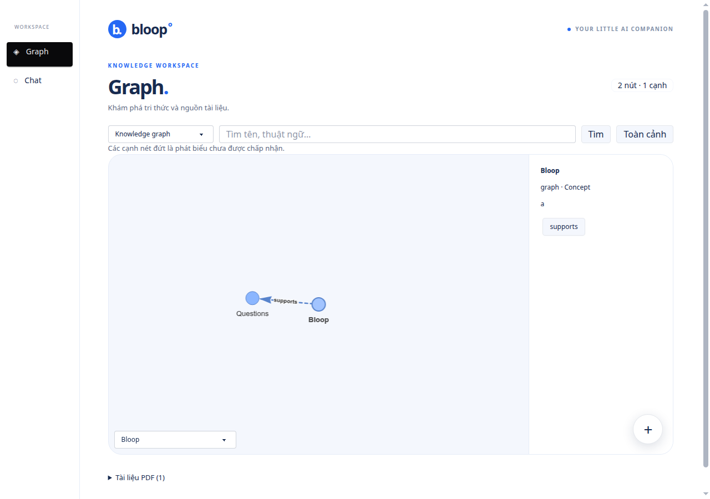
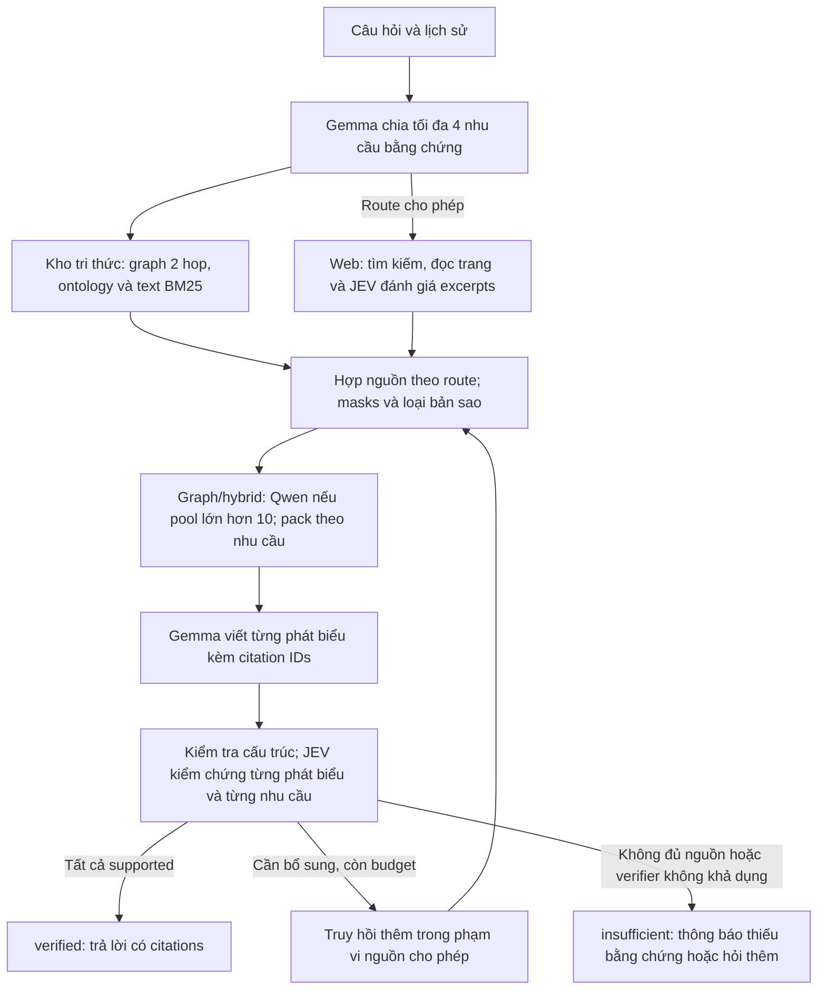

# Bloop - Chatbot y học cổ truyền Việt Nam

**Vietnamese Traditional Medicine Chatbot**

Hỏi đáp về y học cổ truyền Việt Nam, khám phá tri thức từ tài liệu PDF và kiểm tra
nguồn qua từng trích dẫn.

Ask questions about Vietnamese traditional medicine, explore knowledge from PDF
documents, and check the sources behind each answer.

Gemma trích xuất và viết câu trả lời. JEV kiểm tra từng phát biểu với nguồn được
trích dẫn. Người dùng chọn kho tri thức, internet hoặc kết hợp cả hai.



*Ảnh từ browser fixture với dữ liệu mẫu.*

**Graph** có ba nhánh **Knowledge graph / MeSH / VietHerbs**. Chọn node hoặc cạnh
để xem nguồn; nút **+** nhập PDF và hiển thị tiến trình. **Chat** giữ lịch sử,
cho chọn nguồn, mức effort và mở từng citation để kiểm tra bằng chứng.

## Chạy thử

Chạy từ thư mục `web`:

```sh
git lfs install --local
git lfs pull
conda activate bqp
pip install -r backend/requirements.txt -r backend/requirements-decision.txt
cp -n backend/.env.example backend/.env
# Điền FPT_API_KEY và TYPESAFE_API_KEY trong backend/.env.
python backend/main.py
```

Mở **http://127.0.0.1:8000**. Server xây hoặc tái sử dụng snapshot ở background;
Graph sẵn sàng khi index hoàn tất. Chạy **một web worker** để quản lý queue nhập PDF.

Ứng dụng dùng dữ liệu nằm cạnh `web`, trong thư mục dự án `YGiBiTeo`:

| Đường dẫn | Nội dung |
| --- | --- |
| `Dataset/*.pdf` | PDF nguồn local, không đưa lên GitHub; chuẩn bị riêng trước khi xây index |
| `knowledge/dataset-run/dataset_graph.json` | Graph corpus hiện có |
| `knowledge/ontology/core.json` | Types, predicates và domain/range |
| `knowledge/ai-knowledge-graph/src` | Thư viện graph được backend sử dụng |
| `knowledge/MeSH/MESH.ttl`, `knowledge/VietHerbs/VHO.owl` | Thuật ngữ và quan hệ ontology |
| `knowledge/shared/` | Snapshot, sparse index, uploads và traces được tạo khi chạy |

File MeSH được lưu bằng **Git LFS**; cần cài Git LFS trước khi chạy các lệnh trên.
Graph trong `knowledge/dataset-run/` vẫn được lưu trong Git. Thư mục `Dataset/`
được ignore; thêm PDF vào đó hoặc nhập từng PDF qua giao diện.

Có thể tạo index trước bằng `python backend/knowledge_store.py`. CLI này không
gọi FPT/JEV; FastEmbed tải tài nguyên lần đầu rồi cache trong
`knowledge/shared/model-cache`. CLI dùng biến môi trường của shell; server đọc
`backend/.env`. API key nằm ở backend; static files chỉ phục vụ `frontend/`.

## Từ PDF đến kho tri thức


Text được lập chỉ mục độc lập với extraction quan hệ. Một tài liệu xử lí dở vẫn
có thể cung cấp đoạn nguồn cho retrieval. Job lưu checkpoint theo unit; nút
**Tiếp tục** xử lí phần còn lại khi job `partial`, `interrupted` hoặc `failed`.
Mặc định extraction có budget **160 call / 1.800 giây**.

Graph cũ được liên kết lại với PDF và giữ trạng thái `pending`. Explorer hiển thị
cả candidate; trạng thái hiển thị không tự biến một quan hệ thành `accepted`.

## Từ câu hỏi đến câu trả lời



`auto` thử local trước; `hybrid` ghép candidates local với web trước khi rerank.
Draft được giữ ở backend trong lúc kiểm tra. SSE chỉ gửi câu trả lời sau answer
gate; kết quả có citations, `verification_status`, `trace_id`, snapshot và usage.

## Vì sao dùng luồng này?

| Nhu cầu | Cách xử lí và bằng chứng cụ thể |
| --- | --- |
| Giữ đường về PDF gốc | Units lưu page, bbox và offsets; quote phải có trong nguồn. [Test provenance và quote](web/backend/tests/test_pipeline_update.py). |
| Tránh draft tự xác nhận đúng | JEV nhận request riêng. Test giả lập `unknown` trả `insufficient`, không phát hành draft. [Test independent verifier](web/backend/tests/test_pipeline_update.py). |
| Tìm được cả thông tin ngoài graph | Snapshot đã kiểm tra có **120 PDF / 28.850 source units**; retrieval tìm cả text, graph và ontology. [Đường retrieval](web/backend/knowledge_store.py). |
| Giữ retrieval khi reranker lỗi | Qwen lỗi thì giữ thứ tự retrieval, vẫn kiểm chứng câu trả lời. Pool ≤10 bỏ rerank. [Tests fallback và pool nhỏ](web/backend/tests/test_harness.py). |
| Giữ tên và nguồn tách biệt | Namespace riêng; giữ dấu `tri` / `trĩ`; dedup theo nguồn/ngữ cảnh và giữ các assertion khác nhau để kiểm tra. [Tests identity và masks](web/backend/tests/test_pipeline_update.py). |

Snapshot trên được kiểm tra ngày **15/10/2026**. Các tests xác nhận hành vi của
pipeline; chưa phải phép đo độ đúng của mọi câu trả lời trên toàn corpus.

## Mô hình làm việc gì?

| Thành phần | Vai trò |
| --- | --- |
| Gemma qua FPT, mặc định `gemma-4-31B-it` | Lập kế hoạch, trích xuất typed claims và viết draft |
| JEV, mặc định `jev-latest` | Quyết định support cho claims, đánh giá web excerpts và kiểm chứng đáp án |
| `Qwen/Qwen3-Reranker-0.6B`, local | Rerank pool lớn cho graph/hybrid; chọn CUDA hoặc CPU |
| `Qdrant/bm25` + `Modifier.IDF` | Sparse retrieval trên text PDF; lưu vectors thành JSONL, nạp Qdrant memory theo snapshot |
| PhoBERT Medical / BamiBERT | Đang thử nghiệm cho NER; chưa nằm trong runtime |

`KNOWLEDGE_BM25=0` chuyển sang candidate lookup FTS giữ dấu. Thiếu JEV key hoặc
verifier lỗi thì kết quả chưa được xác minh; NER và Qwen không thay answer gate.

## Chọn nguồn và effort

| Route | Hành vi |
| --- | --- |
| `graph` | Chỉ kho tri thức; thiếu nguồn thì hỏi thêm |
| `web` | Chỉ internet; đọc nguồn, JEV đánh giá excerpts rồi pack; không dùng Qwen |
| `hybrid` | Ghép local với web khi được phép rồi rerank/pack |
| `auto` | Thử local; chỉ chuyển web khi `ask_user=false` và source mask cho phép |

`branches` giới hạn `graph` / `mesh` / `vietherbs` / `web`; `documents` giới hạn
document IDs. Khi có `documents`, hoặc `branches` không cho phép `web`, harness
không mở rộng ra internet. `auto` là lựa chọn API; giao diện có ba chế độ nguồn.

Effort giới hạn **vòng / call / deadline**: `low` **1 / 5 / 90 giây**,
`medium` **2 / 8 / 120 giây**, `high` **3 / 11 / 140 giây**. Call gồm cả local và
API; usage báo tách hai loại và token provider trả về. Đây là budget xử lí,
chưa phải giới hạn chi phí tiền tệ.

## API

| Endpoint | Công dụng |
| --- | --- |
| `GET /api/health` | Model, cấu hình và trạng thái snapshot/index |
| `GET /api/graph?branch=mesh&q=...&limit=80` | Vùng graph có giới hạn, tách namespace |
| `GET /api/documents` | Danh sách tài liệu và jobs |
| `POST /api/documents` | Multipart `file`; upload mới trả 202 và job ID |
| `GET /api/documents/{id}` | Tiến trình, accepted/quarantine counts |
| `POST /api/documents/{id}/retry` | Tiếp tục job xử lí dở |
| `POST /api/chat` | SSE `result` → `token` → `done` sau answer gate |

```sh
curl -N http://127.0.0.1:8000/api/chat \
  -H 'Content-Type: application/json' \
  -d '{"messages":[{"role":"user","content":"Nhân sâm được nhắc đến trong tài liệu nào?"}],"route":"graph","effort":"low","ask_user":true}'
```

Trace theo query nằm trong `knowledge/shared/traces`: plan, IDs bằng chứng,
draft sections, verdict, snapshot và usage. Không lưu khóa API hoặc chuỗi suy nghĩ.

## Những phần chính trong code

| File | Nhiệm vụ |
| --- | --- |
| [main.py](web/backend/main.py) | FastAPI, upload, Graph và SSE |
| [ingestion.py](web/backend/ingestion.py), [document_jobs.py](web/backend/document_jobs.py) | Parse PDF, extraction, admission và checkpoint |
| [knowledge_store.py](web/backend/knowledge_store.py) | Import ontology, snapshot và retrieval |
| [harness.py](web/backend/harness.py) | Planner, budget, chọn nguồn và answer gate |
| [evidence.py](web/backend/evidence.py), [reranking.py](web/backend/reranking.py) | Masks, dedup, coverage packing và Qwen |
| [internet.py](web/backend/internet.py) | JEV typed Choice API, search và đọc web |
| [schemas](web/backend/schemas), [evidence policy](web/backend/policies/evidence_policy.json) | Hợp đồng JSON và policy bằng chứng |

## Kiểm tra

Chạy từ `web`; các key dưới đây là giá trị giả cho fixture:

```sh
conda activate bqp
FPT_API_KEY=fixture-key TYPESAFE_API_KEY=fixture-key \
  PYTHONPATH=backend python -m pytest \
  backend/tests/test_harness.py backend/tests/test_reranking.py \
  backend/tests/test_pipeline_update.py -q
node frontend/tests/browser.cjs
```

Ngày **15/10/2026**: **39 backend tests qua**; browser fixture qua Graph/Chat,
ontology selectors, upload/status, citations, viewport 320–768 px và reduced
motion. Fixture không gọi model API; browser cần Chrome và tải các thư viện CDN
mà frontend đang dùng. `backend/tests/smoke_live.py` là phép thử riêng có gọi API thật.

## Phạm vi hiện tại

- PDF scan thiếu native text trả `needs_ocr`; chưa tích hợp OCR.
- Không tự điền ô trống, ghép hàng xuyên trang hoặc biến tên gần giống thành cùng ID.
- `ready` cho biết tiến trình hoàn tất; `accepted` là kết quả admission của pipeline.
  Chất lượng nội dung vẫn cần kiểm định riêng trên gold chuyên gia.
- `.env`, model cache, `docs/` và `mascot_creator/` là tài nguyên local được ignore;
  giữ `.env.example` để chia sẻ cấu hình mà không đưa key vào source.

## References / Nguồn tham khảo

### Dữ liệu và ontology

| Nguồn | Vai trò trong dự án |
| --- | --- |
| [VietHerb — Vietnamese Herbal Medicine Database](https://vietherb.com.vn/) | Nguồn tham khảo về dữ liệu dược liệu Việt Nam |
| [MeSH trên NCBO BioPortal](https://bioportal.bioontology.org/ontologies/MESH), [MeSH — U.S. National Library of Medicine](https://www.nlm.nih.gov/mesh/meshhome.html) | Thuật ngữ y sinh và quan hệ phân cấp cho nhánh MeSH; backend đọc bản TTL local |
| [VietHerbs / VHO](knowledge/VietHerbs/VHO.owl) | Ontology local cho nhánh VietHerbs; giữ URI và assertion của nguồn |

PDF được chuẩn bị riêng trong `Dataset/` hoặc nhập qua giao diện. Trích dẫn trong
câu trả lời trỏ về tài liệu/trang hoặc URL cụ thể đã dùng làm bằng chứng.

### Mã nguồn, mô hình và skill

| Nguồn | Phần được sử dụng |
| --- | --- |
| [AI Powered Knowledge Graph Generator — Robert McDermott](https://github.com/robert-mcdermott/ai-knowledge-graph) | Thư viện graph trong `knowledge/ai-knowledge-graph`; tái sử dụng graph index và truy hồi lân cận |
| [Medical Research Skills — AIPOCH](https://github.com/aipoch/medical-research-skills) | Nguồn tham khảo cho kỹ năng nghiên cứu, kiểm tra claim/citation và văn phong y khoa; đã clone, chưa nạp vào runtime. [Danh sách skill và phiên bản](web/references/README.md) |
| [PyMuPDF](https://github.com/pymupdf/PyMuPDF), [PyOxigraph](https://github.com/oxigraph/oxigraph/tree/main/python) | Đọc PDF và parse ontology RDF/OWL |
| [Qdrant/bm25](https://huggingface.co/Qdrant/bm25), [FastEmbed](https://github.com/qdrant/fastembed), [Qdrant Client](https://github.com/qdrant/qdrant-client) | Tạo sparse vectors và truy hồi BM25 |
| [Qwen3-Reranker-0.6B](https://huggingface.co/Qwen/Qwen3-Reranker-0.6B) | Reranking local cho bằng chứng |
| [Hugging Face Transformers](https://github.com/huggingface/transformers), [PyTorch](https://pytorch.org/) | Runtime cho mô hình local |
| [FastAPI](https://github.com/fastapi/fastapi), [Uvicorn](https://github.com/encode/uvicorn) | API backend, upload và SSE |
| [daisyUI](https://github.com/saadeghi/daisyui) | Các component giao diện |
| [vis-network](https://github.com/visjs/vis-network), [Marked](https://github.com/markedjs/marked), [DOMPurify](https://github.com/cure53/DOMPurify) | Hiển thị graph, render Markdown và làm sạch HTML |
| [DDGS](https://github.com/deedy5/ddgs), [SearXNG](https://github.com/searxng/searxng) | Các đường tìm kiếm web theo cấu hình |
| [Crawl4AI](https://github.com/unclecode/crawl4ai), [Jina Reader](https://github.com/jina-ai/reader) | Đọc nội dung trang nguồn; Crawl4AI là lựa chọn cấu hình riêng |
| [PhoBERT Medical NER](https://huggingface.co/nnguyen96/phobert-medical-finetuned_ner), [BamiBERT-ViMedNER](https://huggingface.co/cbc-528a/BamiBERT-ViMedNER) | Các checkpoint NER đã dùng trong thử nghiệm, chưa nằm trong runtime |

### Dịch vụ suy luận và tìm kiếm

[FPT Cloud](https://fptcloud.com/) cung cấp endpoint Gemma đang cấu hình;
[TypeSafe / JEV](https://docs.typesafe.ai/introduction/quickstart) cung cấp typed
decisions và verification. [Brave Search API](https://brave.com/search/api/) là
một lựa chọn provider tìm kiếm. Các dịch vụ này được ghi nhận riêng với các thư
viện mã nguồn mở ở trên; từng nguồn dữ liệu, mô hình và dịch vụ có điều khoản sử
dụng riêng.
