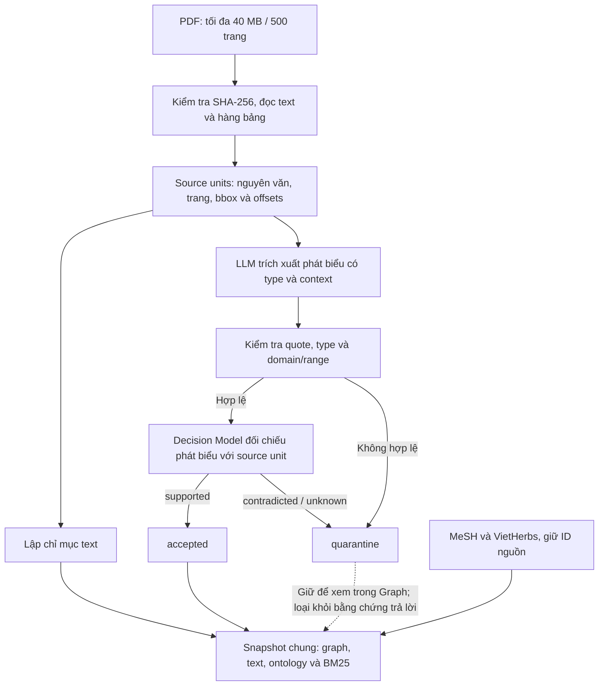
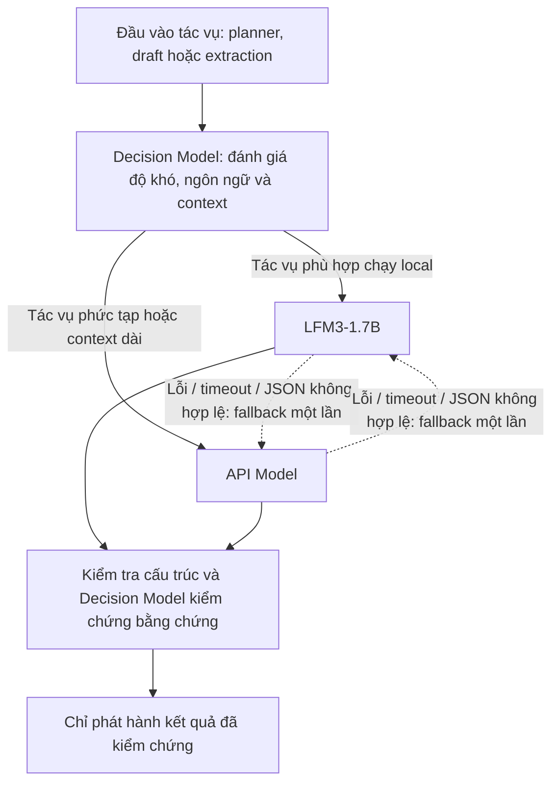
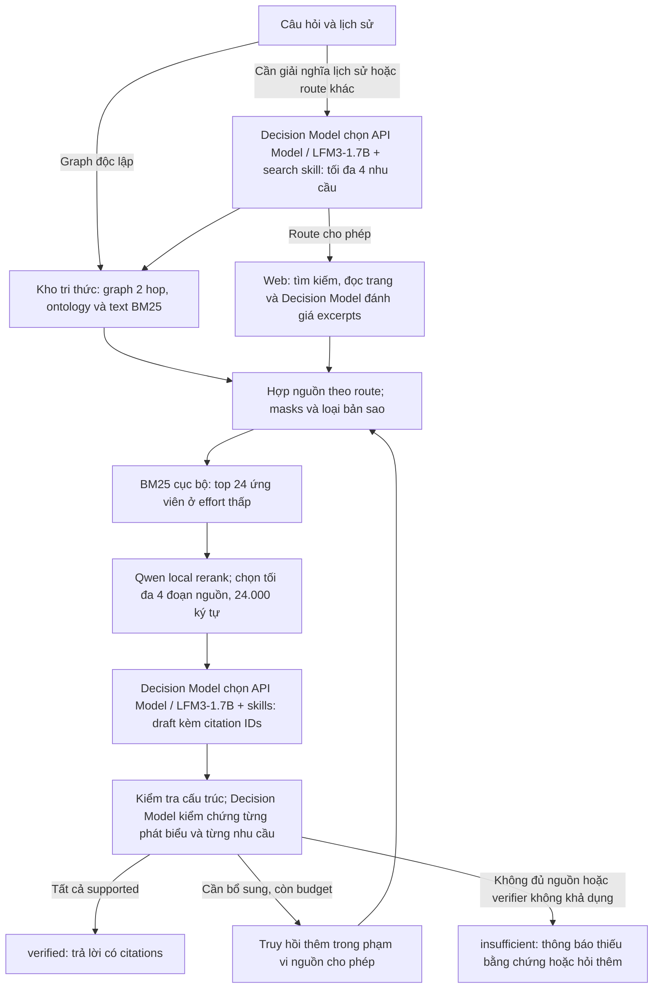

# Bloop - Chatbot y học cổ truyền Việt Nam

**Vietnamese Traditional Medicine Chatbot**

Hỏi đáp về y học cổ truyền Việt Nam, khám phá tri thức từ tài liệu PDF và kiểm tra
nguồn qua từng trích dẫn.

Ask questions about Vietnamese traditional medicine, explore knowledge from PDF
documents, and check the sources behind each answer.

Decision Model đánh giá đầu vào từng tác vụ và chọn **API Model** hoặc **LFM3-1.7B**
để trích xuất và viết câu trả lời; sau đó kiểm tra từng phát biểu với nguồn được
trích dẫn. Người dùng chọn kho tri thức, internet hoặc kết hợp cả hai.


*Ảnh từ browser fixture với dữ liệu mẫu.*

**Graph** có ba nhánh **Knowledge graph / MeSH / VietHerbs**. Chọn node hoặc cạnh
để xem nguồn; nút **+** nhập PDF và hiển thị tiến trình. **Chat** giữ lịch sử,
cho chọn nguồn, mức effort và mở từng citation để kiểm tra bằng chứng.

## Chạy thử

Chạy từ thư mục `web`:

```sh
git lfs install --local
git lfs pull
conda activate bqp
pip install -r backend/requirements.txt -r backend/requirements-decision.txt
cp -n backend/.env.example backend/.env
# Điền FPT_API_KEY và TYPESAFE_API_KEY trong backend/.env.
# Lần đầu startup tải LiquidAI/LFM3-1.7B và Qwen vào backend/.model-cache.
# Node.js >= 20.9; frontend Next.js 16.4.3 + Animate UI.
cd frontend
npm ci
npm run build
cd ..
python backend/main.py
```

Mở **http://127.0.0.1:8000**. FastAPI phục vụ bản export Next.js trong
`web/frontend/out`; cần chạy lại `npm run build` sau khi sửa giao diện.
Frontend dùng App Router, Tailwind CSS 4, daisyUI 5 và Animate UI; không cần CDN
khi chạy. Graph/Chat giữ nguyên lịch sử khi chuyển màn hình. Effort có ba mức;
menu nguồn hỗ trợ phím mũi tên/Escape; popup dẫn chứng hỗ trợ bàn phím và giảm
chuyển động theo cài đặt hệ thống.

Để phát triển: chạy backend ở cổng 8000 và `npm run dev` trong `web/frontend`.
Next chạy cổng 3000 và tự chuyển tiếp `/api` đến backend. Đặt `BACKEND_URL` nếu
backend dùng địa chỉ khác. Không đưa API key vào frontend.

Server khởi động **LFM3-1.7B**, Qwen reranker và kho tri thức cùng nhau trước khi
nhận request. LFM3 dùng checkpoint `LiquidAI/LFM3-1.7B` qua Transformers,
BF16/FP16 trên CUDA hoặc float32 trên CPU. `LFM3_DEVICE=auto` chọn thiết bị;
đặt `cuda` để yêu cầu GPU. Weights và tokenizer dùng chung cho chat và nhập PDF.
Chạy **một web worker** để tránh nạp nhiều bản weights và quản lý queue nhập PDF.

Cả API Model và LFM3 dùng chung **262.144 token tổng input + output** và
**32.768 token output tối đa**, cấu hình bằng `MODEL_CONTEXT_TOKENS` và
`MODEL_MAX_OUTPUT_TOKENS`. Output được giữ chỗ trong cửa sổ context, không cộng
thêm ngoài 262.144 token. Effort vẫn chọn ngân sách bằng chứng/output theo bảng
bên dưới. LFM3 chỉ cấp KV cache cho input thực tế, prefill từng chunk 2.048 token
và chỉ tính logits token cuối để giảm memory. Context hỗ trợ của model không đảm
bảo mọi input 256K đều vừa VRAM 12 GB; vượt context/memory hoặc deadline vẫn
fallback có giới hạn sang API Model, không cắt mất bằng chứng.

Startup log và `/api/health` báo backend, GPU, context/output cap và trạng thái
model. Log routing dùng `lfm3` / `api`, ghi model được chọn, model thực thi và
nguyên nhân fallback. Nếu LFM3 không tải được, server vẫn chạy với API Model.

Ứng dụng dùng dữ liệu nằm cạnh `web`, trong thư mục dự án `YGiBiTeo`:

| Đường dẫn | Nội dung |
| --- | --- |
| `Dataset/*.pdf` | PDF nguồn local, không đưa lên GitHub; chuẩn bị riêng trước khi xây index |
| `knowledge/dataset-run/dataset_graph.json` | Graph corpus hiện có |
| `knowledge/ontology/core.json` | Types, predicates và domain/range |
| `knowledge/ai-knowledge-graph/src` | Thư viện graph được backend sử dụng |
| `knowledge/MeSH/MESH.ttl`, `knowledge/VietHerbs/VHO.owl` | Thuật ngữ và quan hệ ontology |
| `knowledge/shared/` | Snapshot, sparse index, uploads và traces được tạo khi chạy |

File MeSH được lưu bằng **Git LFS**; cần cài Git LFS trước khi chạy các lệnh trên.
Graph trong `knowledge/dataset-run/` vẫn được lưu trong Git. Thư mục `Dataset/`
được ignore; thêm PDF vào đó hoặc nhập từng PDF qua giao diện.

Có thể tạo index trước bằng `python backend/knowledge_store.py`. CLI này không
gọi FPT/Decision Model; FastEmbed tải tài nguyên lần đầu rồi cache trong
`knowledge/shared/model-cache`. CLI dùng biến môi trường của shell; server đọc
`backend/.env`. API key nằm ở backend; static files chỉ phục vụ `frontend/out/`.

## Từ PDF đến kho tri thức



Text được lập chỉ mục độc lập với extraction quan hệ. Một tài liệu xử lí dở vẫn
có thể cung cấp đoạn nguồn cho retrieval. Job lưu checkpoint theo unit; nút
**Tiếp tục** xử lí phần còn lại khi job `partial`, `interrupted` hoặc `failed`.
Mặc định extraction có budget **160 call / 1.800 giây**.

Graph cũ được liên kết lại với PDF và giữ trạng thái `pending`. Explorer hiển thị
cả candidate; trạng thái hiển thị không tự biến một quan hệ thành `accepted`.

## Từ câu hỏi đến câu trả lời

### Dynamic fusion system



Decision Model chấm từng input bằng typed choice `lfm3` / `api`, ưu tiên local
cho tác vụ đơn giản và chọn API Model khi cần suy luận phức tạp vượt khả năng
model local. Cả hai model dùng `MODEL_CONTEXT_TOKENS=262144` và
`MODEL_MAX_OUTPUT_TOKENS=32768`; JEV nhận cùng giới hạn để chọn model;
không cắt mất bằng chứng để vừa context. Mỗi tác vụ chỉ thử mỗi generator tối đa
một lần, trong call budget và deadline hiện có. Model không sẵn sàng được bỏ qua;
nếu cả hai lỗi thì trả lỗi hoặc kết quả chưa đủ bằng chứng. Thiếu API key vẫn có
thể chạy bằng LFM3 nếu model đã sẵn sàng. Khi routing JEV lỗi, ưu tiên LFM3
đang sẵn sàng rồi API Model; answer gate vẫn yêu cầu JEV xác minh.



`auto` thử local trước; `hybrid` ghép candidates local với web trước khi rerank.
Với `graph`, câu hỏi độc lập mặc định dùng `KNOWLEDGE_PLANNER=lexical`, không gọi
LLM để lập kế hoạch. Câu hỏi phụ thuộc lịch sử vẫn có thể cần LLM giải nghĩa.
Đặt `KNOWLEDGE_PLANNER=llm` nếu muốn chủ động dùng planner sinh truy vấn.
Ở effort thấp, luồng thông thường gọi LLM một lần để viết draft ngắn (tối đa 8.192
token), có một lượt Decision Model chọn generator trước đó, sau đó Decision Model
kiểm chứng. Dữ liệu gửi tới mô hình chỉ gồm đoạn
nguồn được chọn và qualifiers; bbox, danh sách unit IDs và metadata chỉ mục được
giữ ở backend. Nguồn dùng chung được gửi một lần cho verifier.
Draft được giữ ở backend trong lúc kiểm tra. SSE chỉ gửi câu trả lời sau answer
gate; kết quả có citations, `verification_status`, `trace_id`, snapshot và usage.

Tám **medical research skills** định hướng tìm tài liệu, mức khẳng định, trích dẫn
và văn phong. Mỗi draft dùng claim verification, strength calibration và reference
integrity; chọn thêm study design/conflict resolver khi phù hợp. Câu trả lời tiếng
Anh dùng precision editor, tiếng Việt dùng plain language profile. Hướng dẫn viết
chạy trước Decision Model, không thêm API call. [Các profile và cách chọn](web/backend/skills/NOTICE.md).

Skill thứ chín, [visualise](web/backend/skills/visualise/SKILL.md), thích ứng ba
hướng dẫn từ OpenGenerativeUI: master playbook, SVG diagrams và advanced visualization.
Agent chọn khi người dùng yêu cầu trực quan, so sánh, mô tả quy trình hoặc hỏi danh
sách biện pháp; yêu cầu chỉ văn bản vẫn trả text. Chat hỗ trợ comparison cards,
các bước, checklist biện pháp độc lập và biểu đồ cột,
có nút chuyển sang văn bản và citations. Visual chỉ lấy nội dung từ các section
đã kiểm chứng; JEV kiểm tra thêm thứ tự, grouping, số liệu và đơn vị trong cùng
batch. Visual không đạt kiểm chứng hoặc sai cấu trúc thì giữ câu trả lời văn bản.
Code HTML/SVG/JS do model sinh không được thực thi. Bản gốc, revision và MIT license
được giữ trong thư mục skill.

Câu hỏi về các bước/quy trình dùng visual `steps`, mỗi thao tác có section và
citations riêng. Nếu model dồn các nhãn liên tiếp `Bước 1: ... Bước 2: ...` vào
một đoạn, backend tách theo đúng nhãn trước khi JEV kiểm chứng, giữ nguyên lời
mở đầu, điều kiện và ghi chú. Không suy đoán thứ tự từ văn bản không có số bước
hoặc dãy số thiếu/trùng. Lời mở đầu hiển thị trước các thẻ; ghi chú chung hiển
thị sau, không tính thành bước. Quy trình hỗ trợ đến 12 bước và tối đa 20 section
kể cả ghi chú, không ép mọi quy trình thành sáu bước. Text và nút chuyển sang
văn bản vẫn có dòng/đoạn riêng cho từng bước khi visual không được phát hành.

Trong Hybrid/Web, các đoạn ngắn dùng để JEV chấm độ liên quan không thay thế nội
dung bài viết đưa vào retrieval. Hệ thống giữ đoạn nguồn liên tục trong giới hạn
context để tránh mất các mục hướng dẫn ngắn không lặp từ khóa. Câu hỏi độc lập
dùng lexical planner ở cả Hybrid/Web; LFM3 có thể tạo checklist đơn giản, còn mọi
claim và cách nhóm visual vẫn phải qua JEV trước khi hiển thị. Số thứ tự checklist
không biểu thị thứ tự thực hiện bắt buộc.
Trong cùng request chọn model, JEV đánh giá nguồn có trả lời đúng quan hệ được hỏi
hay chỉ nhắc cùng chủ đề; ví dụ nghiên cứu chẩn đoán không tự trở thành bằng chứng
phòng bệnh. Khi có nguồn trả lời trực tiếp, generator bỏ các nguồn không liên quan,
giữ nguồn bổ sung và các nguồn thuộc cùng nhóm mâu thuẫn. Bước này không thêm
network call và không thay thế kiểm chứng từng claim. Log `Model source focus`
và `model_routing.source_focus` trong trace ghi số lượng/ID nguồn được giữ.

## Vì sao dùng luồng này?

| Nhu cầu | Cách xử lí và bằng chứng cụ thể |
| --- | --- |
| Giữ đường về PDF gốc | Units lưu page, bbox và offsets; quote phải có trong nguồn. [Test provenance và quote](web/backend/tests/test_pipeline_update.py). |
| Tránh draft tự xác nhận đúng | Decision Model nhận request riêng. Test giả lập `unknown` trả `insufficient`, không phát hành draft. [Test independent verifier](web/backend/tests/test_pipeline_update.py). |
| Tìm được cả thông tin ngoài graph | Snapshot đã kiểm tra có **120 PDF / 28.850 source units**; retrieval tìm cả text, graph và ontology. [Đường retrieval](web/backend/knowledge_store.py). |
| Giữ retrieval khi reranker lỗi | Qwen lỗi thì giữ thứ tự lexical; pool không vượt top-k đáp án thì bỏ rerank. Vẫn kiểm chứng câu trả lời. [Tests fallback và pool nhỏ](web/backend/tests/test_harness.py). |
| Giữ tên và nguồn tách biệt | Namespace riêng; giữ dấu `tri` / `trĩ`; dedup theo nguồn/ngữ cảnh và giữ các assertion khác nhau để kiểm tra. [Tests identity và masks](web/backend/tests/test_pipeline_update.py). |

Snapshot trên được kiểm tra ngày **15/10/2026**. Các tests xác nhận hành vi của
pipeline; chưa phải phép đo độ đúng của mọi câu trả lời trên toàn corpus.

## Mô hình làm việc gì?

| Thành phần | Model / cấu hình mặc định | Vai trò |
| --- | --- | --- |
| API Model | FPT `gemma-4-31B-it`; `FPT_MODEL`, `FPT_BASE_URL`, `FPT_API_KEY` | Generator cho tác vụ JEV chọn; fallback cho LFM3-1.7B |
| LFM3-1.7B | `LiquidAI/LFM3-1.7B`; `LFM3_DEVICE=auto`, revision pinned trong `.env.example` | Generator local BF16/FP16, nạp cùng Qwen; fallback cho API Model |
| Decision Model | JEV `jev-latest`; `TYPESAFE_MODEL`, `TYPESAFE_API_KEY` | Chọn generator cho từng input, đánh giá excerpts, kiểm chứng claims và đáp án |
| Qwen reranker | `Qwen/Qwen3-Reranker-0.6B`; `QWEN_RERANKER_DEVICE=auto` | Rerank pool lớn cho graph/hybrid; chọn CUDA hoặc CPU |
| Sparse retrieval | `Qdrant/bm25` + `Modifier.IDF` | Sparse retrieval text PDF; vectors JSONL, Qdrant memory theo snapshot |
| NER thử nghiệm | PhoBERT Medical / BamiBERT | Chưa nằm trong runtime |

`LFM3_STARTUP_TIMEOUT_SECONDS=600` giới hạn tải/warmup; `MODEL_TIMEOUT_SECONDS=600`
áp dụng cho inference API và local, trong deadline effort. `LFM3_MODEL_PATH` cho
phép dùng snapshot local; `LFM3_PREFILL_CHUNK_TOKENS=2048` giới hạn activation khi
prefill dài. Revision pin giữ nguyên custom model code đã kiểm tra; adapter giữ
đúng các layer convolution và RoPE khi chạy trên Transformers 5.17.
`/api/health` báo `local_model`, `local_model_runtime`, `model_context_tokens`,
`model_max_output_tokens` và `local_model_ready`. Chat result/trace có
`model_routing` với selected/used, attempts và fallback. JEV và từng lần thử
model đều được tính vào usage; independent JEV verification vẫn bắt buộc.
Khi tokenizer local sẵn sàng, router đếm input bằng tokenizer LFM3 và giữ chỗ
output trước cả hai route. JSON/schema được ràng buộc khi decode bằng LM Format
Enforcer; lỗi cấu trúc vẫn không được bỏ qua để phát hành đáp án.

`KNOWLEDGE_BM25=0` chuyển sang candidate lookup FTS giữ dấu. Thiếu Decision Model key hoặc
verifier lỗi thì kết quả chưa được xác minh; NER và Qwen không thay answer gate.
`FPT_ENABLE_THINKING=0` mặc định tắt suy luận nội bộ cho Gemma 4 và DeepSeek V4
trong các tác vụ JSON có giới hạn token. Không tự tăng token; phản hồi bị cắt có
thể fallback sang generator còn lại một lần. `usage` phân biệt số lượt API/local, ký tự API/local, reasoning token
(nếu nhà cung cấp báo) và kích thước tập bằng chứng qua từng vòng retrieval.

## Chọn nguồn và effort

| Route | Hành vi |
| --- | --- |
| `graph` | Chỉ kho tri thức; thiếu nguồn thì hỏi thêm |
| `web` | Chỉ internet; đọc nguồn, Decision Model đánh giá excerpts rồi pack; không dùng Qwen |
| `hybrid` | Ghép local với web khi được phép rồi rerank/pack |
| `auto` | Thử local; chỉ chuyển web khi `ask_user=false` và source mask cho phép |

`branches` giới hạn `graph` / `mesh` / `vietherbs` / `web`; `documents` giới hạn
document IDs. Khi có `documents`, hoặc `branches` không cho phép `web`, harness
không mở rộng ra internet. `auto` là lựa chọn API; giao diện có ba chế độ nguồn.

Effort giới hạn **vòng / call / deadline**: `low` **1 / 7 / 180 giây**,
`medium` **2 / 11 / 300 giây**, `high` **3 / 15 / 600 giây**. Call gồm cả routing JEV, local và
API; usage báo tách hai loại và token provider trả về. Đây là budget xử lí,
chưa phải giới hạn chi phí tiền tệ.

Giới hạn bằng chứng graph/hybrid; giới hạn token draft áp dụng cho mọi route:

| Effort | Ứng viên cho rerank | Đoạn nguồn tối đa | Ký tự bằng chứng tối đa | Token draft tối đa |
| --- | ---: | ---: | ---: | ---: |
| low | 24 | 4 | 24.000 | 8.192 |
| medium | 32 | 6 | 48.000 | 16.384 |
| high | 40 | 8 | 96.000 | 32.768 |

## API

| Endpoint | Công dụng |
| --- | --- |
| `GET /api/health` | Model, skill profile và trạng thái snapshot/index |
| `GET /api/graph?branch=mesh&q=...&limit=80` | Vùng graph có giới hạn, tách namespace |
| `GET /api/documents` | Danh sách tài liệu và jobs |
| `POST /api/documents` | Multipart `file`; upload mới trả 202 và job ID |
| `GET /api/documents/{id}` | Tiến trình, accepted/quarantine counts |
| `POST /api/documents/{id}/retry` | Tiếp tục job xử lí dở |
| `POST /api/chat` | SSE `result` → `token` → `done` sau answer gate |

```sh
curl -N http://127.0.0.1:8000/api/chat \
  -H 'Content-Type: application/json' \
  -d '{"messages":[{"role":"user","content":"Nhân sâm được nhắc đến trong tài liệu nào?"}],"route":"graph","effort":"low","ask_user":true}'
```

Trace theo query nằm trong `knowledge/shared/traces`: plan, IDs bằng chứng,
draft sections, verdict, snapshot và usage. Trường `skills` trong kết quả/trace ghi
phiên bản, fingerprint và IDs đã dùng cho planner và từng draft. Không lưu khóa API
hoặc chuỗi suy nghĩ.

## Những phần chính trong code

| File | Nhiệm vụ |
| --- | --- |
| [main.py](web/backend/main.py) | FastAPI, upload, Graph và SSE |
| [ingestion.py](web/backend/ingestion.py), [document_jobs.py](web/backend/document_jobs.py) | Parse PDF, extraction, admission và checkpoint |
| [knowledge_store.py](web/backend/knowledge_store.py) | Import ontology, snapshot và retrieval |
| [harness.py](web/backend/harness.py) | Planner, budget, chọn nguồn và answer gate |
| [model_router.py](web/backend/model_router.py), [local_model.py](web/backend/local_model.py) | JEV routing, fallback API Model ↔ LFM3-1.7B, shared startup và inference |
| [visualisation.py](web/backend/visualisation.py), [visualise](web/backend/skills/visualise/SKILL.md) | Visual specs dựa trên sections, kiểm chứng và render tương tác trong chat |
| [medical_skills.py](web/backend/medical_skills.py), [skills](web/backend/skills/NOTICE.md) | Chọn và nạp profile nghiên cứu/văn phong từ package local |
| [evidence.py](web/backend/evidence.py), [reranking.py](web/backend/reranking.py) | Masks, dedup, coverage packing và Qwen |
| [internet.py](web/backend/internet.py) | Decision Model typed Choice API, search và đọc web |
| [schemas](web/backend/schemas), [evidence policy](web/backend/policies/evidence_policy.json) | Hợp đồng JSON và policy bằng chứng |

## Kiểm tra

Chạy từ `web`; các key dưới đây là giá trị giả cho fixture:

```sh
conda activate bqp
FPT_API_KEY=fixture-key TYPESAFE_API_KEY=fixture-key \
  PYTHONPATH=backend python -m pytest \
  backend/tests/test_harness.py backend/tests/test_reranking.py \
  backend/tests/test_model_routing.py backend/tests/test_startup.py \
  backend/tests/test_pipeline_update.py backend/tests/test_medical_skills.py -q
# Build frontend first: cd frontend && npm ci && npm run build
node frontend/tests/browser.cjs
```

Ngày **15/10/2026**: **49 backend tests qua**, gồm chọn/nạp skill và giữ Decision Model gate;
browser fixture qua Graph/Chat,
ontology selectors, upload/status, citations, viewport 320–768 px và reduced
motion. Fixture không gọi model API; browser cần Chrome và tải các thư viện CDN
mà frontend đang dùng. `backend/tests/smoke_live.py` là phép thử riêng có gọi API thật.

## Phạm vi hiện tại

- PDF scan thiếu native text trả `needs_ocr`; chưa tích hợp OCR.
- Không tự điền ô trống, ghép hàng xuyên trang hoặc biến tên gần giống thành cùng ID.
- `ready` cho biết tiến trình hoàn tất; `accepted` là kết quả admission của pipeline.
  Chất lượng nội dung vẫn cần kiểm định riêng trên gold chuyên gia.
- `.env`, model cache, `docs/` và `mascot_creator/` là tài nguyên local được ignore;
  giữ `.env.example` để chia sẻ cấu hình mà không đưa key vào source.

## References / Nguồn tham khảo

### Dữ liệu và ontology

| Nguồn | Vai trò trong dự án |
| --- | --- |
| [VietHerb — Vietnamese Herbal Medicine Database](https://vietherb.com.vn/) | Nguồn tham khảo về dữ liệu dược liệu Việt Nam |
| [MeSH trên NCBO BioPortal](https://bioportal.bioontology.org/ontologies/MESH), [MeSH — U.S. National Library of Medicine](https://www.nlm.nih.gov/mesh/meshhome.html) | Thuật ngữ y sinh và quan hệ phân cấp cho nhánh MeSH; backend đọc bản TTL local |
| [VietHerbs / VHO](knowledge/VietHerbs/VHO.owl) | Ontology local cho nhánh VietHerbs; giữ URI và assertion của nguồn |

PDF được chuẩn bị riêng trong `Dataset/` hoặc nhập qua giao diện. Trích dẫn trong
câu trả lời trỏ về tài liệu/trang hoặc URL cụ thể đã dùng làm bằng chứng.

### Mã nguồn, mô hình và skill

| Nguồn | Phần được sử dụng |
| --- | --- |
| [AI Powered Knowledge Graph Generator — Robert McDermott](https://github.com/robert-mcdermott/ai-knowledge-graph) | Thư viện graph trong `knowledge/ai-knowledge-graph`; tái sử dụng graph index và truy hồi lân cận |
| [Medical Research Skills — AIPOCH](https://github.com/aipoch/medical-research-skills) | Tám profile đã tích hợp vào planner/draft: nghiên cứu, kiểm tra claim/citation và văn phong y khoa. Kèm bản nguồn, giấy phép MIT và manifest phiên bản. [Danh sách skill và phiên bản](web/references/README.md) |
| [OpenGenerativeUI — althetinkerer](https://github.com/althetinkerer/opengenerativeui) | Profile `visualise`; giữ ba guide nguồn tại revision cố định và MIT license. Adapter cho cards, steps, checklist và bar charts qua answer gate |
| [PyMuPDF](https://github.com/pymupdf/PyMuPDF), [PyOxigraph](https://github.com/oxigraph/oxigraph/tree/main/python) | Đọc PDF và parse ontology RDF/OWL |
| [Qdrant/bm25](https://huggingface.co/Qdrant/bm25), [FastEmbed](https://github.com/qdrant/fastembed), [Qdrant Client](https://github.com/qdrant/qdrant-client) | Tạo sparse vectors và truy hồi BM25 |
| [Qwen3-Reranker-0.6B](https://huggingface.co/Qwen/Qwen3-Reranker-0.6B) | Reranking local cho bằng chứng |
| [LFM3-1.7B — Liquid AI](https://huggingface.co/LiquidAI/LFM3-1.7B) | Generator local 1.73B, 256K context, chat template chính thức; LFM Open License v1.0 |

| [Hugging Face Transformers](https://github.com/huggingface/transformers), [PyTorch](https://pytorch.org/) | Runtime LFM3 và Qwen reranker |
| [LM Format Enforcer](https://github.com/noamgat/lm-format-enforcer) | Ràng buộc JSON/schema khi LFM3 sinh planner, answer và extraction |
| [FastAPI](https://github.com/fastapi/fastapi), [Uvicorn](https://github.com/encode/uvicorn) | API backend, upload và SSE |
| [daisyUI](https://github.com/saadeghi/daisyui) | Các component giao diện |
| [vis-network](https://github.com/visjs/vis-network), [Marked](https://github.com/markedjs/marked), [DOMPurify](https://github.com/cure53/DOMPurify) | Hiển thị graph, render Markdown và làm sạch HTML |
| [DDGS](https://github.com/deedy5/ddgs), [SearXNG](https://github.com/searxng/searxng) | Các đường tìm kiếm web theo cấu hình |
| [Crawl4AI](https://github.com/unclecode/crawl4ai), [Jina Reader](https://github.com/jina-ai/reader) | Đọc nội dung trang nguồn; Crawl4AI là lựa chọn cấu hình riêng |
| [PhoBERT Medical NER](https://huggingface.co/nnguyen96/phobert-medical-finetuned_ner), [BamiBERT-ViMedNER](https://huggingface.co/cbc-528a/BamiBERT-ViMedNER) | Các checkpoint NER đã dùng trong thử nghiệm, chưa nằm trong runtime |

### Dịch vụ suy luận và tìm kiếm

[FPT Cloud](https://fptcloud.com/) cung cấp endpoint LLM đang cấu hình;
[TypeSafe / Decision Model](https://docs.typesafe.ai/introduction/quickstart) cung cấp typed
decisions và verification. [Brave Search API](https://brave.com/search/api/) là
một lựa chọn provider tìm kiếm. Các dịch vụ này được ghi nhận riêng với các thư
viện mã nguồn mở ở trên; từng nguồn dữ liệu, mô hình và dịch vụ có điều khoản sử
dụng riêng.
